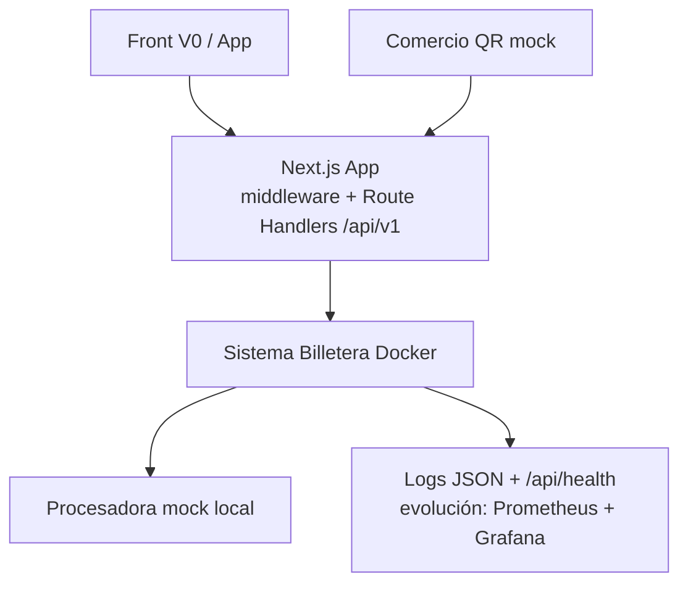
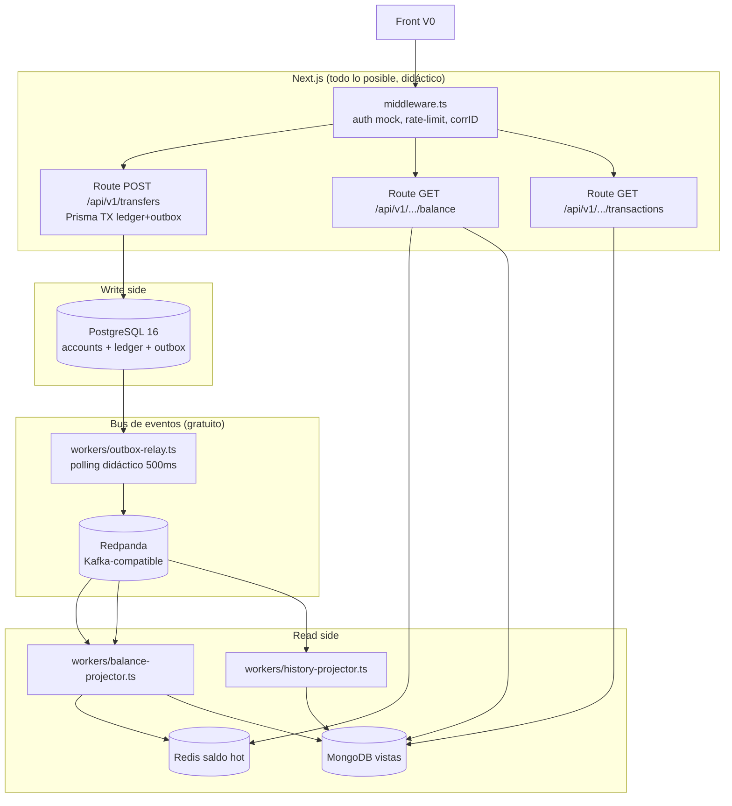
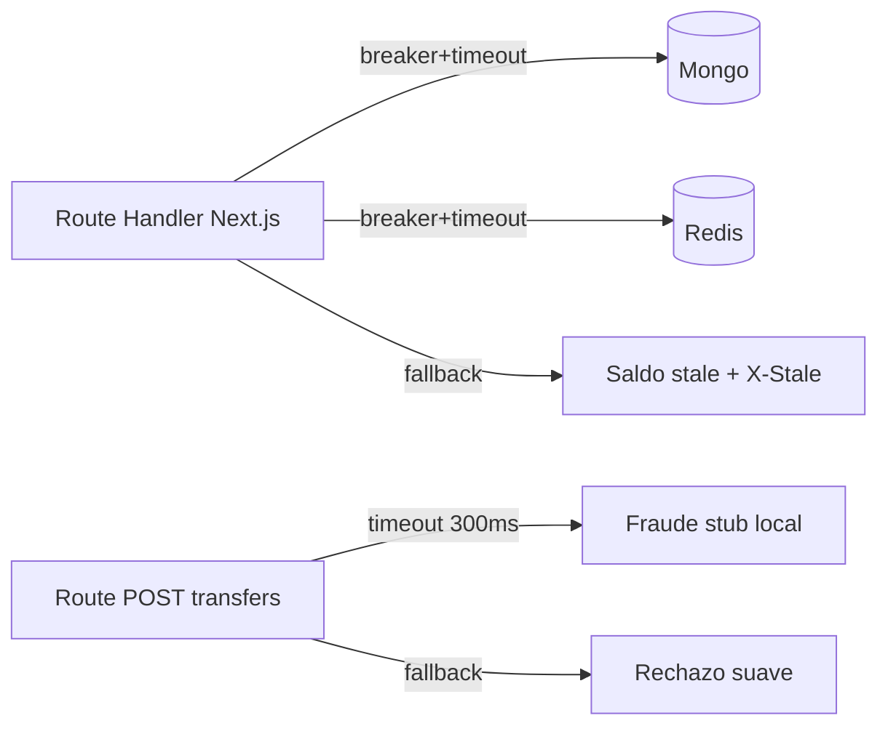

# Arquitectura — Billetera Virtual (CQRS + Event-Driven)

## 1. Vista de contexto (C4 L1)

## 2. Vista de contenedores (C4 L2)

## 3. Por qué CQRS aquí

| Aspecto | Escritura | Lectura |
|---|---|---|
| Volumen | Bajo (~5k/s) | Masivo (~50k/s) |
| Consistencia | Fuerte (ACID, RPO=0) | Eventual (<2s aceptable) |
| Latencia objetivo | p95 <800ms | p95 <150ms |
| Modelo óptimo | Normalizado + constraints | Desnormalizado + caché |
| Escalado | Vertical + sharding por hash | Horizontal agresivo + réplicas |

Intentar servir ambas con el mismo modelo llevaría a `SUM(ledger)` o JOINs bajo carga → colapso en Hot Sale.

## 4. Decisiones clave y alternativas descartadas

| Decisión | Elegido (gratuito/didáctico) | Descartado y por qué |
|---|---|---|
| Backend | Next.js 14 Route Handlers + Prisma (TS, aprendible, gratis) | .NET/C# (curva extra, no didáctico aquí) |
| DB escritura | PostgreSQL 16-alpine local | Oracle/pago (costo, no docker simple) |
| Publicación eventos | Outbox + relay polling TS (`workers/outbox-relay.ts`) → Redpanda | Dual-write (pierde eventos); Debezium directo en MVP (pesado Java, mejor fase 2) |
| Bus Kafka | Redpanda (1 contenedor, API Kafka, gratis) | Kafka+Zookeeper 3 brokers (pesado para aprender en laptop) |
| Lectura historial | Mongo Community desnormalizado | Vista materializada en PG (acopla lectura al primario) |
| Caché saldo | Redis OSS / Valkey | Caché en memoria local (no compartida entre réplicas) |
| Gateway | `middleware.ts` Next.js (auth mock + rate-limit + corrID) | Kong/APIM pago (overkill MVP local) |
| Concurrencia | OCC + CHECK | Lock pesimista global (mata throughput) |
| Orden eventos | Key Redpanda = account_id | Orden global (no escala) |

Ver `adr/` para el registro formal.

## 5. Escalabilidad y resiliencia

### 5.1 Escalado local con Docker (sin K8s en MVP)

- Todo stateless en Docker Compose. Escala manual didáctica: `docker compose up --scale history-projector=3`.
- Next.js: réplicas con `docker compose up --scale app=2` + balanceo simple (o Caddy opcional).
- PG local: 1 primario + backup volumen; HA/Patroni y sharding como ejercicio fase 2.
- Redpanda: 1 nodo + 6 particiones por tópico hot, key=`account_id` (orden por cuenta).
- Mongo local: 1 nodo + índice `{account_id, created_at}`; sharding como fase 2.
- Redis local: 1 nodo + TTL; cluster como fase 2.

### 5.2 Degradación elegante + Circuit Breaker

- Si historial cae → saldo y pagos siguen (página de movimientos muestra banner "temporalmente no disponible").
- Bulkhead: pools de conexiones separados para lectura/escritura/proyección.
- Retry solo en errores retriables (500/503/429) con jitter; nunca reintentar 422/403.

### 5.3 Picos (Hot Sale / Cyber Monday)

1. Pre-escalado programado (cron HPA minReplicas x3).
2. Rate limit adaptativo en Gateway + cola de absorción Kafka (el ledger nunca recibe más de lo que PG soporta; el resto espera en cola de entrada si se usa async para fondeo).
3. Feature flags: desactivar historial detallado / comisiones en tiempo real si el lag crece.
4. Load shedding: 429 con `Retry-After` antes que 500.

## 6. Seguridad (resumen, 100% local)

- JWT mock local (`JWT_SECRET` en `.env`, sin IdP pago), autorización por `sub == account.owner`.
- PII demo (alias, email) sin datos reales; en prod cifrar a nivel columna + Vault.
- Idempotency-Key + rate limit middleware como defensa anti doble-clic.
- Auditoría: tabla `audit_log` append-only + `correlation_id` (ver `data-model.md`).
- `npm audit` en CI; imágenes base oficiales `*-alpine`.

## 7. Riesgos arquitectónicos

| Riesgo | Prob. | Impacto | Plan |
|---|---|---|---|
| Hot account (comercio top) contención OCC | Media | Alta latencia | Fila de serialización por cuenta + `FOR UPDATE` selectivo + caché de escritura agregada |
| Lag Redpanda crece sin cota | Media | Lectura stale | Escalar projectors con compose + DLQ + replay + alerta log |
| Split-brain Redis | Baja (1 nodo local) | Saldo inconsistente | `version` como árbitro (solo acepta `version` mayor) |
| Relay detenido | Baja | Sin proyección | Alerta si `outbox` sin despachar >30s + `docker compose restart outbox-relay` |
