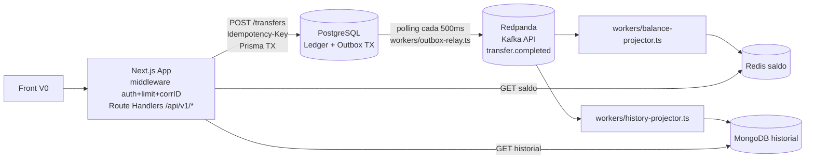
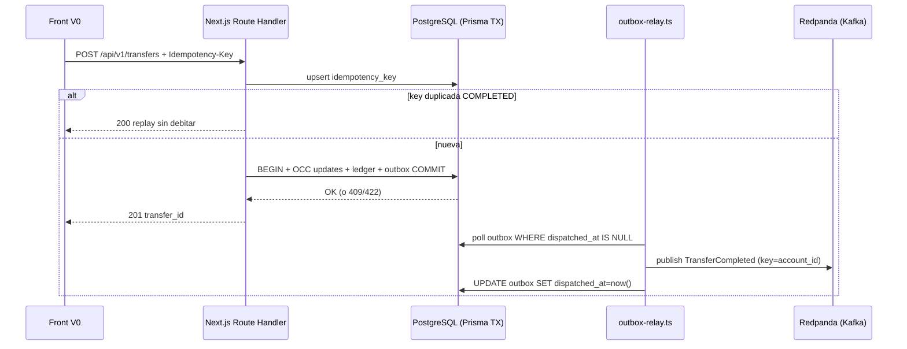

# PLAN-001: Diseño técnico — Billetera Virtual (CQRS + Event-Driven, stack Next.js didáctico)

**Responde al:** `spec.md` | **Stack v1.1 (100% gratuito + dockerizado):** Next.js 14 App Router TypeScript (Route Handlers + middleware) + Prisma ORM + PostgreSQL 16-alpine (ledger) + Redpanda (Kafka-compatible, 1 contenedor) + MongoDB 7 Community (lectura) + Redis 7 (caché) + workers Node `kafkajs`. Sin .NET, sin Oracle, sin Debezium obligatorio, sin K8s obligatorio. Todo con `docker compose up`.

## 1. Patrones core

**CQRS estricto con Next.js:**

- **Write Model (comandos):** Route Handlers `apps/web/src/app/api/v1/transfers/route.ts` → Prisma `$transaction` → PostgreSQL (ACID). No sirve historial masivo.
- **Read Model (consultas):** Route Handlers `.../balance/route.ts`, `.../transactions/route.ts` → Redis/Mongo. Nunca escriben el ledger. Se actualizan solo por eventos Redpanda.
- **Dónde vive cada cosa en Next.js (didáctico):** `src/app/api` = controladores, `src/lib` = infra (prisma/mongo/redis/kafka), `src/middleware.ts` = gateway (auth mock + rate-limit + correlation-id), `workers/` = relay + projectors, `prisma/schema.prisma` = ledger+outbox.



## 2. Flujo de escritura (ledger a prueba de fallos)

### Paso a paso (transferencia P2P en Next.js)

1. **Middleware Next.js (`src/middleware.ts`, hace de Gateway gratuito):** valida JWT mock, aplica rate limit en memoria/Redis (20 escrit/min), genera/propaga `X-Correlation-Id`.
2. **Idempotencia (primera barrera, `route.ts` + Prisma):** `upsert` en `idempotency_keys` con `ON CONFLICT DO NOTHING`. Si existe `COMPLETED` → devuelve respuesta cacheada + `Idempotent-Replayed: true`. Si `IN_PROGRESS` → 409.
3. **Validaciones:** cuenta existe, no bloqueada, `monto>0`, `origen!=destino`, antifraude stub local (timeout 300ms).
4. **Transacción ACID Prisma (única TX, ver `workers` y `LEARN-OUTBOX-KAFKA.md` para el porqué):**
   ```sql
   BEGIN;
   SELECT balance, version FROM accounts WHERE id=:origen FOR UPDATE; -- o OCC vía UPDATE ... WHERE version=:v
   -- validar saldo
   UPDATE accounts SET balance=balance-:monto, version=version+1 WHERE id=:origen AND version=:v;
   UPDATE accounts SET balance=balance+:monto, version=version+1 WHERE id=:destino AND version=:vd;
   INSERT INTO ledger_entries (transfer_id, account_id, type, amount, ...) VALUES (...debit...), (...credit...);
   INSERT INTO outbox (event_id, aggregate, topic, payload) VALUES (...);
   UPDATE idempotency_keys SET status='COMPLETED', response=:json WHERE key=:k;
   COMMIT;
   ```
    - OCC preferido (columna `version` Prisma); `SELECT FOR UPDATE` solo para hot accounts.
    - Constraint `CHECK (balance >= 0)` como última defensa en DB.
5. **Outbox → Redpanda (patrón estrella didáctico, detalle en `LEARN-OUTBOX-KAFKA.md`):** `workers/outbox-relay.ts` hace polling `SELECT ... WHERE dispatched_at IS NULL FOR UPDATE SKIP LOCKED LIMIT 100` cada 500ms, publica en Redpanda con key=`account_id`, y marca `dispatched_at`. Si el relay muere a mitad, el evento sigue `NULL` y se reintenta — sin pérdida, sin dual-write. Debezium queda como fase 2 opcional.
6. **Respuesta:** 201 + `transfer_id` + saldos resultantes. V0 reusa la misma `Idempotency-Key` ante reintentos.

### Diagrama de secuencia



## 3. Flujo de lectura (alta concurrencia)

| Componente | Rol | Detalle |
|---|---|---|
| Consumidores Kafka | Proyectan eventos | Grupo `balance-projector` y `history-projector`, idempotentes por `event_id`, commit manual tras upsert |
| MongoDB | Read model historial | Colección `account_views {account_id, balance_snapshot, movements[] embebidos últimos N + colección movements por cuenta}` desnormalizada con el formato exacto de la app |
| Redis | Saldo hot | `balance:{account_id} -> {balance, version, updated_at}` TTL 60-300s + invalidación/actualización por evento; `SET NX` + Lua para actualización solo si `version` mayor |

**Estrategia de lectura saldo:**

1. `GET balance` → Redis. Hit → p95 <50ms.
2. Miss → MongoDB `account_views` → repuebla Redis.
3. Si Mongo cae → último valor Redis con `X-Stale: true` + métrica `stale_served_total`.
4. Nunca `SUM(ledger)` en request path.

## 4. Topología Docker (gratuita, sin K8s obligatorio)

`docker-compose.yml` (único requisito: Docker Desktop):
- `postgres:16-alpine` (ledger), `redpandadata/redpanda` (Kafka en 1 contenedor, sin Zookeeper), `mongo:7`, `redis:7-alpine`, `app` (Next.js, `Dockerfile` multi-stage), `outbox-relay` + `balance-projector` + `history-projector` (mismo Dockerfile, distinto `CMD` con `tsx`).
- Red: `billetera-net`. Volúmenes nombrados para persistencia local. Puertos: 3000 (Next), 5432, 19092 (Redpanda Kafka), 27017, 6379.
- Env en `apps/web/.env.example` (DATABASE_URL, REDPANDA_BROKERS, MONGO_URL, REDIS_URL, JWT_SECRET mock). V0 apunta a `http://localhost:3000/api/v1/*`.

## 5. Escalabilidad y resiliencia en local (detalle en `non-functional.md`)

- **Sin HPA en MVP local:** `docker compose up --scale` manual + límites CPU/mem en compose. K8s/HPA como fase 2 documentada.
- **Breaker simple en Next.js** (sin Polly): wrapper `withBreaker()` + timeouts `AbortController` entre route→mongo/redis y route→fraude stub.
- **Graceful degradation:** historial degradado no bloquea saldo/pago (flag + fallback a Redis stale).
- **Particionamiento didáctico:** Redpanda 6 particiones por tópico hot, key=`account_id`. Sharding PG/Mongo como ejercicio fase 2.
- **Backpressure:** si lag crece, escalar projectors con `docker compose up --scale history-projector=3`; si Redis cae, passthrough a Mongo con rate limit.

## 6. Orden de implementación (resumen didáctico Next.js)

1. `docker-compose.yml` + Next.js + Prisma ledger + idempotencia + outbox (relay log, sin Redpanda aún).
2. Redpanda + `outbox-relay.ts` + projector mínimo → Mongo + Redis (el corazón didáctico Outbox→Kafka).
3. APIs lectura + degradación + OpenAPI para V0.
4. Middleware (auth mock, rate limit, corrID) + seed + observabilidad mínima.
5. Endurecimiento: OCC bajo contención, particiones Redpanda, chaos con `docker stop`.

Ver `tasks.md` para el desglose ejecutable y `architecture.md` para vistas C4.
